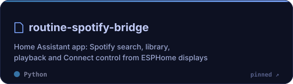
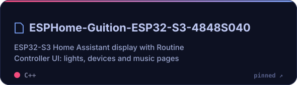
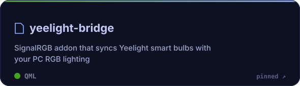
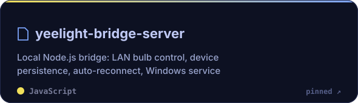
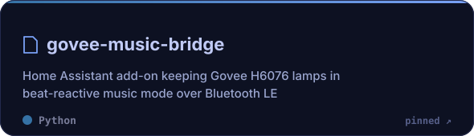
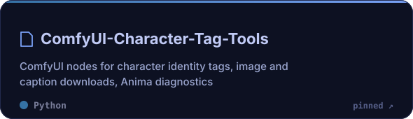

  

  Developer from Ukraine who turns manual routines into software. 
  If I do something twice, the third time it's a script. The fourth time it's an agent.

  
  

### 🧭 What I work on

| | Direction | What it looks like |
|:-:|---|---|
| 🧠 | **AI agents & LLM tooling** | Agents that run real workflows end to end: MCP tools, Codex / Claude automations, browser control |
| 🏠 | **Smart home & IoT** | <b>Home Assistant</b> as the brain of the house: custom voice assistant with its own wake word, daily routine tracking and reminders, TV &amp; Sonos media scenes, local DNS with AdGuard Plus a Yeelight ↔ SignalRGB bridge that syncs room lights with the PC |
| 🛒 | **E-commerce automation** | Marketplace integrations, XML product feeds, price parity, payments, Shopify stores |
| 🎨 | **Generative AI pipelines** | ComfyUI workflows, LoRA training, vision models that rank and filter outputs, AI video |
| ⚙️ | **Backend & serverless** | Spring and Node.js services, AWS Lambda functions, payment webhooks |
| 🤖 | **Bots & parsers** | Telegram bots, job and odds parsers, headless browser automation |
| 📈 | **Trading & crypto** | Arbitrage and AI trading bots, market data collectors |
| 🎬 | **Real-time 3D & motion** | Unreal Engine 5 cinematics, Rive animations |

### 🧰 Stack

  

### 📊 Stats

  

### 📌 Pinned

  
  

  
  

  
  

### 🐍 Contributions

  <picture>
    <source media="(prefers-color-scheme: dark)" srcset="https://raw.githubusercontent.com/artur-safonov/artur-safonov/output/github-snake-dark.svg" />
    <source media="(prefers-color-scheme: light)" srcset="https://raw.githubusercontent.com/artur-safonov/artur-safonov/output/github-snake.svg" />
    
  </picture>

